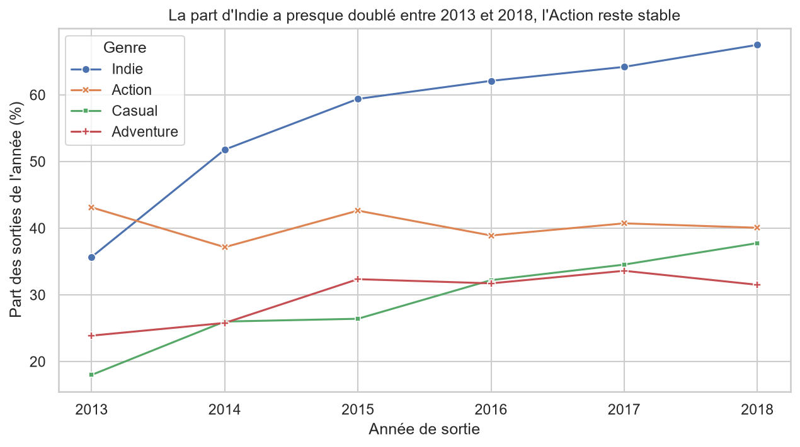
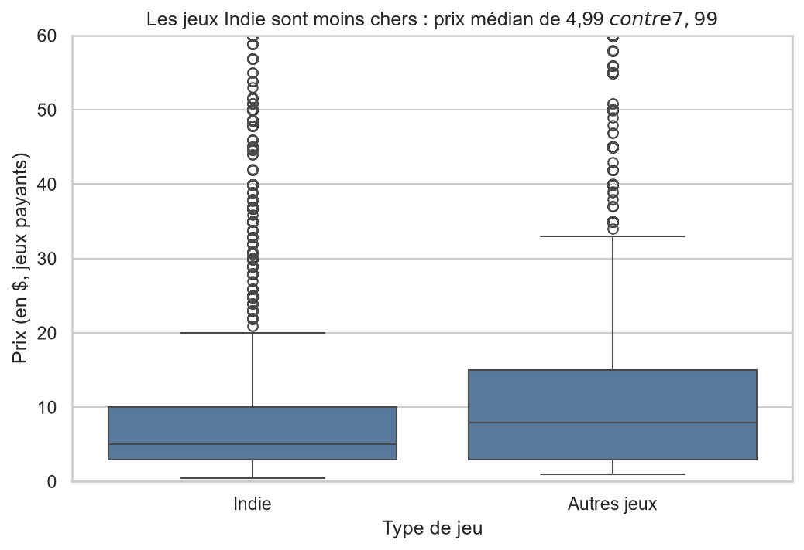
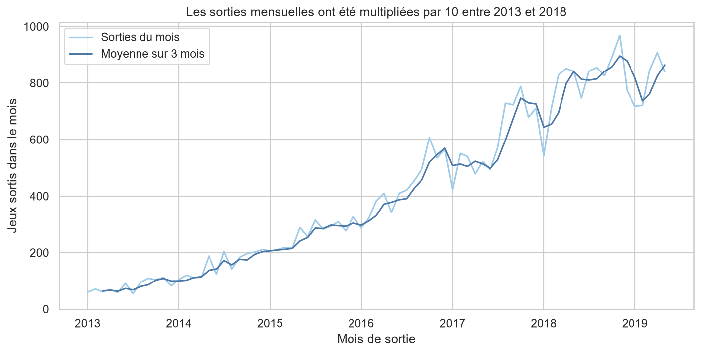

# Mini Projet d'un jeu de données : Analyse du catalogue Steam

Analyse d'un jeu de données de plus de 40 000 produits du catalogue Steam (jeux vidéo, lots, abonnements) : nettoyage, agrégations, visualisations.

## Questions étudiées

1. Quels genres dominent le catalogue, et leur part évolue-t-elle dans le temps ?
2. Les jeux Indie sont-ils moins chers que les autres ?
3. Les réductions sont-elles plus fréquentes sur certains genres ?
4. Plus de langues supportées signifie-t-il de meilleurs avis ?
5. Combien de jeux sortent par mois ?

## Source des données

- **Jeu de données** : [Steam Games Complete Dataset](https://www.kaggle.com/datasets/trolukovich/steam-games-complete-dataset) (Kaggle)
- **Fichier utilisé** : `steam_games.csv`, 40 833 lignes et 20 colonnes
- **Licence** : CC0, domaine public

## Structure du projet

```
projet-analyse-video-games/
├── data/
│   ├── raw/              # fichier d'origine (non versionné, voir plus bas)
│   └── processed/        # fichier nettoyé, produit par le notebook 02
├── notebooks/
│   ├── 01_exploration.ipynb
│   ├── 02_nettoyage.ipynb
│   └── 03_analyse.ipynb
├── src/
├── figures/              # graphiques enregistrés par le notebook 03
├── requirements.txt
├── .gitignore
└── README.md
```

## Installation

Le projet a été développé avec Python [version : 3.14.7].

```bash
git clone https://github.com/Dylan-For-AI/projet-analyse-video-games.git
cd projet-analyse-video-games
python -m venv .venv

# Windows (PowerShell)
.venv\Scripts\activate
# Windows (Git Bash)
source .venv/Scripts/activate
# macOS et Linux
source .venv/bin/activate

pip install -r requirements.txt
```

## Accès aux données

Le fichier brut pèse 81 Mo : il n'est **pas** versionné dans Git (dossier `data/raw/` ignoré).

1. Télécharger `steam_games.csv` sur la [page Kaggle du jeu de données](https://www.kaggle.com/datasets/trolukovich/steam-games-complete-dataset).
2. Le placer dans `data/raw/steam_games.csv`.

Le fichier nettoyé (`data/processed/steam_clean.csv`, environ 13 Mo) est lui versionné : le notebook 03 peut donc être exécuté sans retélécharger le fichier brut.

## Ordre d'exécution

Dans VS Code, choisir le noyau `.venv`, puis lancer chaque notebook avec **Restart** puis **Run All** :

| Notebook | Rôle | Fichier lu | Fichier produit |
|---|---|---|---|
| `01_exploration.ipynb` | Chargement et inspection du fichier brut | `data/raw/steam_games.csv` | aucun |
| `02_nettoyage.ipynb` | Nettoyage justifié et chiffré | `data/raw/steam_games.csv` | `data/processed/steam_clean.csv` |
| `03_analyse.ipynb` | Agrégations, jointures, visualisations, conclusions | `data/processed/steam_clean.csv` | `figures/*.png` |

## Le nettoyage en bref

Le fichier passe de 40 833 lignes et 20 colonnes à **37 618 lignes et 12 colonnes**. Chaque décision est justifiée et chiffrée dans le journal de nettoyage, à la fin du notebook 02. Les principales :

- 2 812 lignes supprimées : les lots (`bundle`), abonnements (`sub`) et pages qui ne sont pas des jeux
- 14 lignes sans nom et 2 doublons (même nom et même date) supprimés
- 387 lignes sans genre ou sans langue supprimées (variables centrales des questions)
- prix convertis en nombres : les jeux gratuits valent 0, les textes libres (démos) deviennent manquants
- 330 prix aberrants mis en manquant : prix écrits sans `$` et prix supérieurs à 200 $ répétés à l'identique sur de nombreux jeux sans rapport (valeurs de remplissage)
- colonne `en_reduction` reconstruite : `discount_price` est inférieur au prix d'origine pour seulement 2 625 jeux sur 11 637, la colonne brute n'est donc pas fiable
- 31 dates de sortie postérieures à 2019 mises en manquant (dates annoncées, pas de vraies sorties)
- 8 colonnes supprimées (plus de 60 % de manquants ou longs textes inutilisés)

## Principaux résultats

**Les genres.** L'Indie est le genre le plus fréquent (61 % des jeux), devant l'Action (41 %). Entre 2013 et 2018, la part d'Indie dans les sorties passe de 36 % à 68 %, alors que celle de l'Action reste stable autour de 40 %.



**Les prix.** Les jeux Indie sont moins chers : prix médian de 4,99 $ contre 7,99 $ pour les autres jeux payants.



**Les réductions.** 8,3 % des jeux sont en réduction (sur 28 323 jeux dont la réduction est fiable). Le taux varie de 2,7 % (Massively Multiplayer) à 11,7 % (Casual).

**Les langues et les avis.** Le lien est très faible : 78 % d'avis positifs en médiane pour les jeux à une langue, 81 % pour ceux à 11 langues ou plus. Les jeux multilingues reçoivent surtout plus d'avis.

**Les sorties.** Le nombre moyen de jeux sortis par mois passe d'environ 81 en 2013 à 807 en 2018.



Tous les graphiques sont dans le dossier `figures/`, et le détail des calculs et des conclusions dans `notebooks/03_analyse.ipynb`.

## Limites de l'analyse

- **Période** : le jeu de données a été collecté vers juin 2019. L'analyse des sorties s'arrête à mai 2019, car les mois suivants sont incomplets.
- **Réductions** : 9 295 jeux (25 %) sont exclus de la question 3 car leur `discount_price` n'est pas interprétable. Un jeu sans `discount_price` est supposé ne pas être en réduction à la date de collecte. Les genres Free to Play et Early Access sont mécaniquement peu réduits.
- **Prix** : 3 600 jeux n'ont pas de prix fiable et 2 672 jeux gratuits sont exclus de la comparaison des prix. Les prix sont des dollars de la période de collecte.
- **Avis** : seuls 46 % des jeux ont une note (au moins 10 avis). La corrélation observée entre langues et avis ne prouve aucune cause.
- **Dates** : 1 963 jeux (5 %) n'ont pas de date de sortie exploitable.
- **Genres** : un jeu a plusieurs genres, donc les parts par genre ne s'additionnent pas.

## Auteur

Dylan RAMI